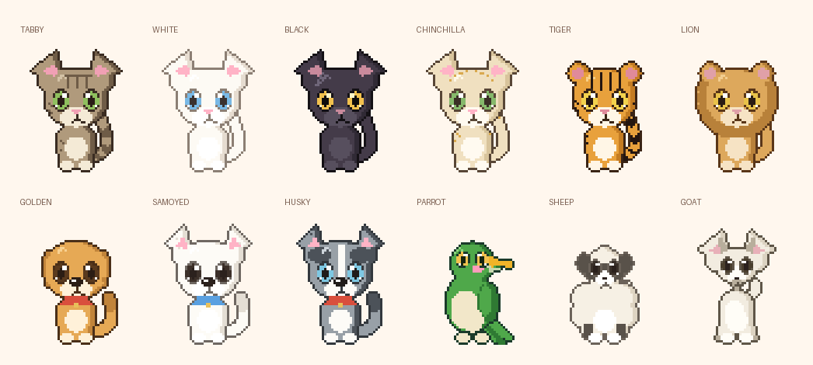
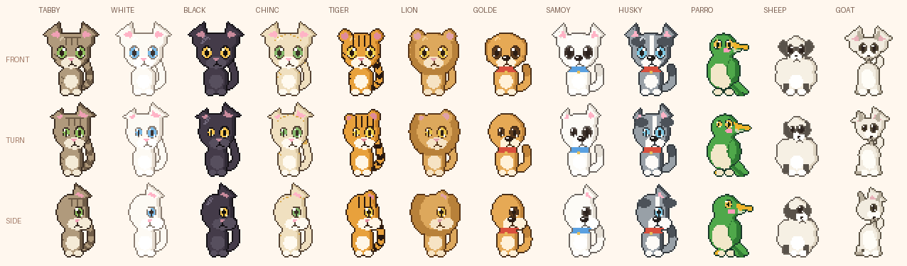
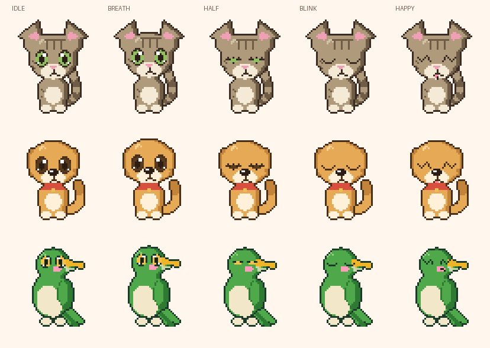

# dsh-pet

悬浮在 DeepSeek Harness 网页界面上的像素电子宠物：按住它拖到窗口任意位置，点一下它会跳起来、冒爱心、说一句话。十二个品种，各自有各自的脾气和动作节奏，而且都会**正面站着**和**侧过身**两种样子。

## 品种与性格



| 品种 | 性格 | 表现在动画上 |
| --- | --- | --- |
| 狸花猫 | 机警、利落、野性足 | 眨眼快、耳朵常抖（2.4–4.2s）、一直在东张西望（2–3.6s）、尾巴抽得急 |
| 白猫 | 优雅、高冷、慢条斯理 | **慢眨眼**（闭眼 260ms，猫的示好）、几乎不抖耳（7–12s）、动作幅度小、跳得轻 |
| 黑猫 | 神秘、安静、爱盯着人 | 几乎不动：尾巴 4 拍才摆一下、一次凝视 1.8s、很久才眨一次眼 |
| 金渐层 | 懒、贪睡、黏人 | **会打盹**（每 9–15s 睡 3.2s，头顶冒 zZ，被摸会醒）、呼吸最慢、摸一下给 4 颗爱心 |
| 金毛 | 热情、黏人、尾巴闲不住 | **一直吐舌头**、尾巴 1 拍一摆、跳得欢、摸一下给 4 颗爱心 |
| 萨摩耶 | 笑口常开、弹跳力惊人 | 一直吐舌头 + 一直在笑、**跳得最高**（1.55 倍）、尾巴不停 |
| 哈士奇 | 戏多、突然发疯、爱嗷呜 | **每隔 7–12s 原地发疯 1.5s**（左右乱窜 + 自带台词）、耳朵抖得最勤、张望最快 |
| 老虎 | 沉稳、有分量、护尾巴 | 呼吸慢、尾巴摆得慢但幅度大、眨眼 3.2–5.2s、跳起来落地沉 |
| 狮子 | 威严、慢性子 | 动一下是一下：抖耳 8–13s、一次凝视 1.5s、跳得最低（0.85 倍） |
| 鹦鹉 | 又快又爱动、话多 | **眨眼最快**（1.5–2.6s）、抖头 1.6–2.8s、张望最频繁、蹦跶幅度最大（1.3 倍） |
| 绵羊 | 胆小、柔软 | 呼吸最慢（11 拍一循环）、抖耳 7–12s、弹跳最轻（0.6 倍） |
| 山羊 | 好奇又犟、动作利落 | 眨眼 2.8–4.4s、张望快、蹦得干脆、呼吸中等偏慢 |

## 功能

- **悬浮 + 可拖**：注册在 `shell.overlay` 这个整帧浮层里，位置用 `position: fixed` 自己管，和左右栏、滚动容器都无关；拖到哪儿都行，视口变化时自动收回边界内。
- **点一下有反应**：跳一下、甩尾巴、头顶冒爱心（数量看品种），并随机说一句该品种专属台词；点完自动回到待机。
- **换品种**：右下角的爪印按钮打开品种面板，每一项都是这只宠物真实缩小后的头像（同一套像素代码渲染），选中即切换并记住。
- **会记住**：品种、位置、被摸过几次都存在 `localStorage` 的 `dsh.pet.v1` 里，刷新页面还在原地。
- **键盘也能玩**：聚焦后方向键移动（12px 一格），回车/空格等于点一下。
- **不打扰**：浮层本身点击穿透，只有宠物这一小块接收指针事件；`prefers-reduced-motion` 下不启动动画节拍，形象保持静态。

## 正面与侧面



每个品种都有三档朝向：**正面**（`turn = 0`）、**侧转四十五度**（`turn = 0.5`）、**侧面**（`turn = 1`），朝左时整张图水平镜像。三档不是三套图，而是同一套几何按 `turn` 连续推出来的：

- 五官、口鼻、爪子、耳朵按 `turn` 往朝向一侧平移，远侧那只眼睛一边缩一边往中间靠，到侧面就整个藏起来（侧面只留一只眼睛）；
- 侧面时脑袋收窄、口鼻往前鼓出轮廓，尾巴摆到身后，躯干也略微收窄，读起来才像"转过去了"；
- 转身是**一档一档走**的：90ms 走一档，正面 ⇄ 侧转 ⇄ 侧面，共约 180ms；要换边时先转回正面再翻面，不会"啪"地镜像过去。

它会自己转身：指针靠近时偏一点只转眼珠，偏到 62px 以上先转四十五度，偏到身侧（>118px 且竖直方向不太偏）才整个侧过去；指针走远自动转回正面。拖动时朝向跟着拖动方向走；偶尔东张西望也是侧过身看一眼再转回来。

## 美术

像素画是**手绘代码**，没有任何外部素材——整只宠物由 48×54 的字符网格算出来：

- 先按几何形状铺色块（椭圆脑袋、圆角身体、各类耳朵、口鼻、项圈），再自动在轮廓外描 1px 深色边，最后压花纹、点五官；耳朵先画、脑袋后压，耳窝就不会溢到脸上；
- 形体按 `species` 分成五套：`cat`（坐姿猫科）、`dog`（坐姿犬科）、`bird`（蛋形身体 + 钩喙 + 长尾羽 + 爪子）、`sheep`（一团羊毛 + 四条短腿 + 深色小脸）、`goat`（瘦长身体 + 后弯的角 + 山羊胡 + 蹄子）；狮子的鬃毛、老虎的虎纹、鹦鹉的喙都是这一层上的可选项；
- 花纹是品种差异的关键：狸花的额头三道虎斑 + 尾巴环、哈士奇的额头白色火焰纹 + 深色帽子、金渐层的金色毛尖、黑猫的冷调高光、萨摩耶的耳缘浅灰；
- 眼睛是 5×5 的独立图层（虹膜色随品种：绿、蓝、金、褐），所以能跟着鼠标转、能单独眨眼；
- 渲染时把同色的横向连续格子合并成一条 `<path>`，整只宠物只要十几个路径元素，`shape-rendering: crispEdges` + 2 倍整数缩放（48×54 → 96×108），放大后依旧是硬边像素。

## 动画

所有动作都是**重新生成一格像素网格**，不是缩放或补间，所以放大后不会糊。



| 动作 | 帧 |
| --- | --- |
| 呼吸 | 头与耳朵整体上抬 1px |
| 摇尾 | 贝塞尔尾巴 4 个相位，节奏按品种（黑猫 4 拍一摆，金毛 1 拍一摆） |
| 眨眼 | 睁 → 半闭 → 闭合 → 半闭 → 睁，间隔与闭眼时长按品种 |
| 抖耳朵 | 耳尖抖一下（猫耳上抬、狗耳下垂） |
| 东张西望 | 侧过身看一眼再转回来，间隔与停留时长按品种 |
| 眼睛跟鼠标 | 指针靠近时眼睛朝指针偏移（±1 格）；**口鼻、鼻子、嘴跟着一起挪**，眼嘴始终在同一张脸上；偏到侧面才换成转身，指针走远自动转回正面 |
| 眼睛贴脸 | 眼睛是独立图层，画之前要压在身体像素上：`turn` 越大脑袋越窄，近侧眼睛**几乎留在原地、略微上抬并缩小**（往前甩的是鼻子和嘴），远侧眼睛边缩边往中间收，保证四档表情在每档转身下都不会顶出轮廓、也不会压到嘴上 |
| 眼嘴同步 | 全套五官共用一套锚点：眼珠看向哪边，口鼻、鼻子、嘴和吐舌一起平移；转身时鼻子和嘴往前摆，眼睛留在原处并上抬 |
| 远近遮挡 | 眼睛分近侧 / 远侧两只，远侧那只转到口鼻**后面**：口鼻凸起占住的格子（`snoutCells`）会把它盖掉，只剩露在毛发上的部分，转满档时彻底隐入；远眼同时收缩、往中间收，小脑袋品种收得更少，免得和近侧那只糊成一只 |
| 转身 | 正面 ⇄ 侧转半档 ⇄ 侧面，90ms 一档；换边先转回正面再镜像 |
| 打盹 | 金渐层专属：闭眼 + zZ 飘字，被摸会醒 |
| 发疯 | 哈士奇专属：左右乱窜 1.5s + 台词 |
| 被摸 | 压缩起跳（高度按品种）+ 爱心 + 台词 |

## 文件

| 文件 | 作用 |
| --- | --- |
| `package.json` | bundle 清单：`dsh.bundle.patch` + `dsh.client`（web / immediately） |
| `cordis.patch.yml` | 往 profile 里插一行 `dsh-pet` |
| `index.js` | Host 半，只有 `export function apply() {}`，不注册任何东西 |
| `client.js` | 精灵引擎 + 十二个品种 + 三档转身 + 性格参数 + 悬浮组件 + 内置 CSS |
| `locale/zh.json`、`locale/en.json` | 插件管理面板里显示的标题和说明 |
| `icon.svg` | 像素猫头图标（由同一套精灵代码生成） |
| `preview.png`、`poses.png`、`animation.png` | README 用的预览图，由精灵代码渲染 |

## 安装

```bash
# 在仓库根目录
./install.sh plugin dsh-pet --profile web
```

`desktop` profile 归 DeepSeek Harness 应用独占，命令行装不进去（`install.sh` 会直接拦下并给出提示），要在应用内「插件」页从本地目录安装，指向 `plugins/dsh-pet`。装完刷新页面即可看到停在右下角的狸花猫。

卸载：应用内「插件」页移除，或 `./install.sh uninstall plugin dsh-pet`。`localStorage` 里的记录会留着，重新装回来还在原地。

自测：

```bash
cd plugins/dsh-pet && node --test
```

## 已知限制

- 只支持 Web 端（`dsh.client.platform: web`），桌面端和 TUI 没有可用的浮层。
- 形象是 48×54 的手绘像素图。要更细就得重画网格：所有几何常量都直接写在 `client.js` 的精灵区里，`W`/`H` 一改，描边、花纹、五官的位置都要跟着调。
- 人物形象还没做。精灵区已经按 `species` 把「形体 + 耳朵 + 五官版式」拆成可替换的实现（目前 `cat` / `dog` / `bird` / `sheep` / `goat`），加一个 `human` 能直接复用眼睛、花纹、表情、转身和整套动画状态机，但站姿躯干和四肢得重画。
- 侧面是**参数化推出来的**，只有 0 / 0.5 / 1 三档，没有更细的角度；想要"回头 30 度"这种中间姿态，得再加档并调 `turnShift` 的系数。
- 鹦鹉按设计就是侧头（喙朝一侧），所以正面那一档也是偏的，不做左右对称。
- 交互目前只有「点击摸一下」；喂食、跟着鼠标跑、多宠物同屏留给后续版本。
- 位置以视口左上角为基准存在 `localStorage`，换浏览器或换窗口尺寸会重新夹取到边界内。
